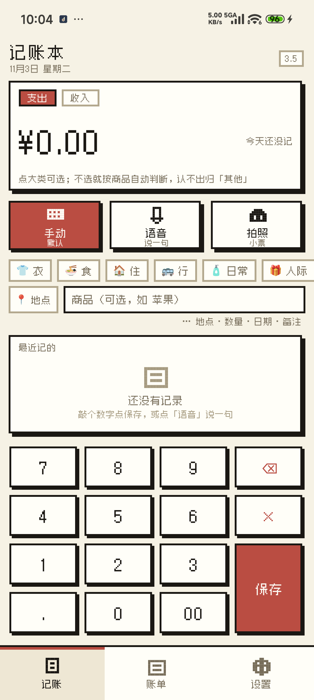
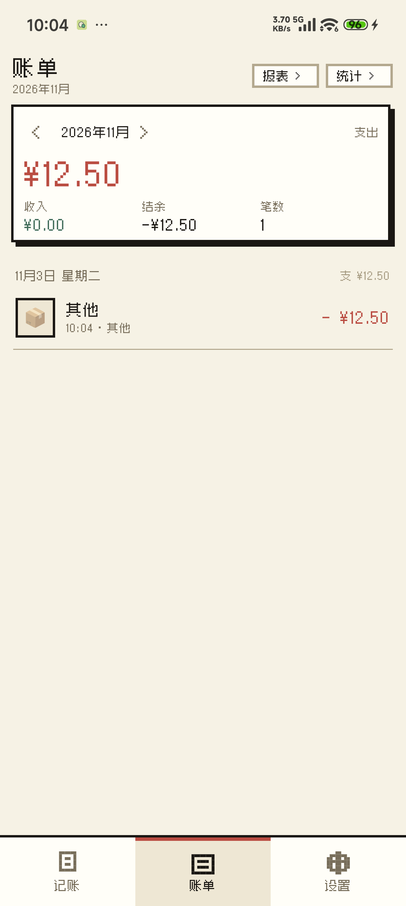
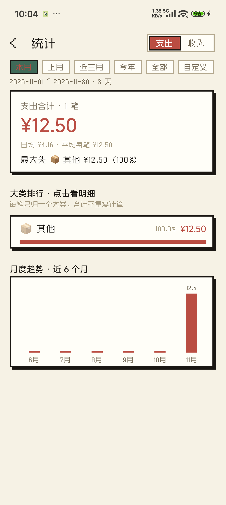
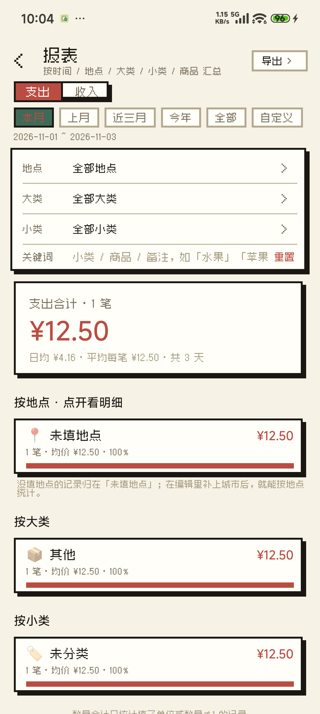
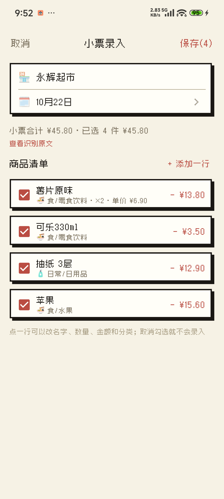
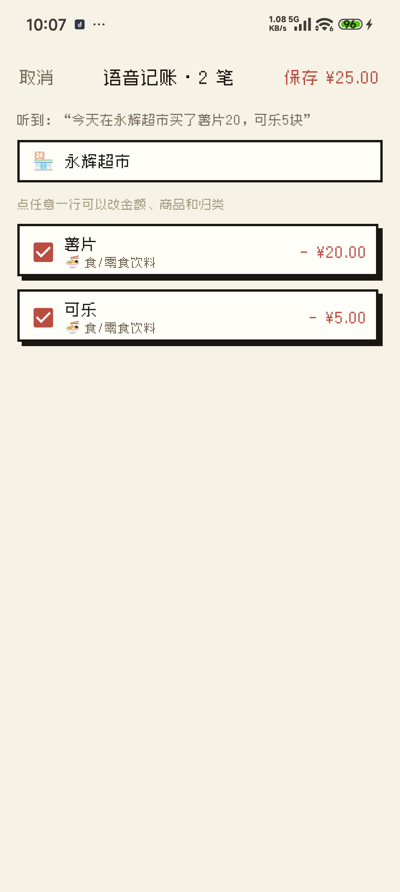
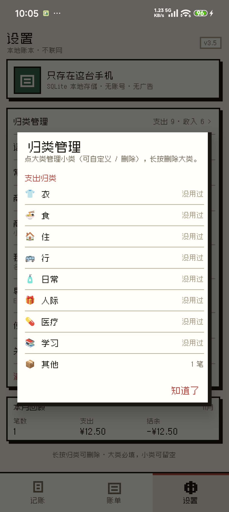
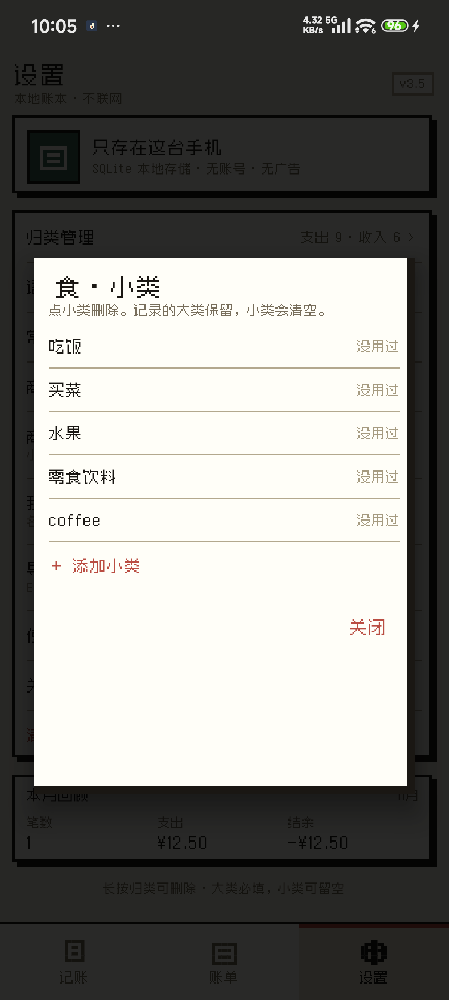
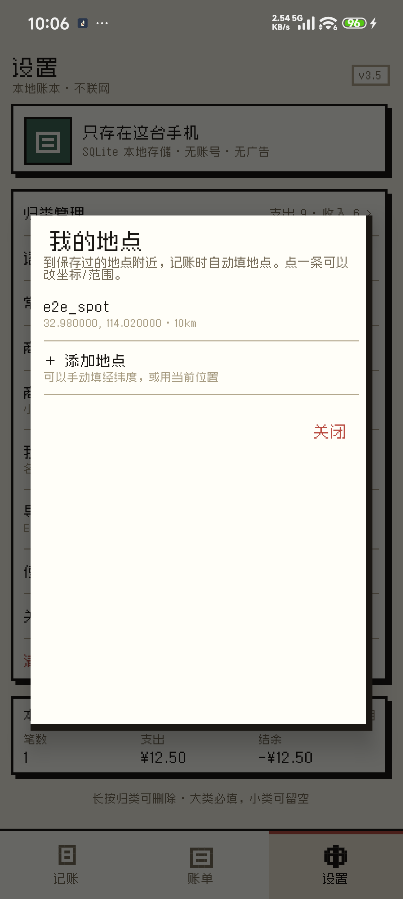

# 记账本 (MoneyBook) 3.5

[](https://github.com/ker0491/MoneyBook/releases) [](LICENSE)

📥 **[下载 APK](https://github.com/ker0491/MoneyBook/releases/latest)** · 只支持 arm64-v8a 手机

一个轻量的安卓记账 App：说一句话或拍张小票就能记账，App 自己把消费归到「衣 / 食 / 住 / 行 / 日常 / 人际 / 医疗 / 学习 / 其他」9 个生活大类，再细到「水果 / 买菜 / 请客吃饭」这些小类；除了日常账，也能按旅行记录时间、地点、商品和数量，最后按「某段时间 / 某地 / 某类 / 买了多少斤」出报表。
全部数据保存在手机本地 SQLite，**不联网、无广告、无需账号**。

3.2 换成了整体像素风：小票质感配色、方角硬边、实心投影，中文全部使用 Zpix 像素字体（`res/font/zpix.ttf`，作者 SolidZORO，个人项目免费使用，见 [licenses/Zpix-LICENSE.md](licenses/Zpix-LICENSE.md)）。
3.3 在这个基础上补齐了数据字段（时间 / 地点 / 大类 / 小类 / 数量）、旅行消费报表和数据导出。
3.4 把分类换成 9 个生活大类 + 小类 + 商品三层：只有大类必填，小类/商品可以留空；语音、小票、快捷记账共用一套自动归类和商品记忆，手动改一次以后就记住。
3.5 小类可以自己加、自己删（删掉只清空记录里的小类，大类保留）；地点改成「名称 + 坐标 + 范围」的「我的地点」，到附近自动填，同名地点直接更新坐标；小票 OCR 会按 EXIF 摆正照片、提高分辨率并在认不出时旋转重试，多列/条码小票也能解析，还能查看识别原文；小票里的商家名认错一次，手动改对后下次自动更正。

## 截图

<table>
<tr>
<td></td>
<td></td>
<td></td>
</tr>
<tr>
<td align="center">记账（键盘直接敲）</td>
<td align="center">账单</td>
<td align="center">统计</td>
</tr>
<tr>
<td></td>
<td></td>
<td></td>
</tr>
<tr>
<td align="center">报表</td>
<td align="center">小票 OCR</td>
<td align="center">语音多件确认</td>
</tr>
<tr>
<td></td>
<td></td>
<td></td>
</tr>
<tr>
<td align="center">归类管理</td>
<td align="center">自定义小类</td>
<td align="center">我的地点</td>
</tr>
</table>

## 三个页面

底部三个 tab：

```
记账（默认）  账单  设置
```

记账页打开就是数字键盘，敲金额 → 点红色「保存」即可，不用先选归类：

- 大类必填；不选就按商品自动判断，认不出归「其他」。小类和商品都可以留空
- 大类选中后下面出现小类 chips（水果 / 买菜 / 请客吃饭……），不选就自动猜
- 地点默认用新鲜定位匹配「我的地点」（10km 内），匹配不到才用内置城市兜底；点一下可手动选/记住当前位置；保存后留在记账页，方便接着记下一笔
- 金额卡右侧显示今天已记的笔数和收支合计
- 「最近记的」显示最近 5 笔，底部「查看全部账单 ›」直接跳到账单页
- 「手动 / 语音 / 拍照」三个入口并排：手动是默认，语音说一句，拍照扫小票
- 「⋯ 地点 · 数量 · 日期 · 备注」进完整编辑页（日期用自绘像素日历）

## 一句话记账

记账页点「语音」直接说，长按「语音」可以改为键盘敲一句话（不方便说话时用）。多件商品识别完先给你确认，不会直接存：

| 你说 | App 怎么记 |
| --- | --- |
| 今天在永辉超市买了薯片20，可乐5块 | 永辉超市 2 笔：食/零食饮料，日期今天 |
| 充电30度50块 | 1 笔：行/车辆 ¥50，数量 30 度 |
| 淘宝买了双鞋199 | 1 笔：衣/服饰鞋包 ¥199 |
| 昨天打车二十三块五 | 1 笔：行/公共交通 ¥23.5，日期昨天 |
| 买苹果18.8 | 1 笔：食/水果 ¥18.8 |
| 请客吃饭300 | 1 笔：人际/请客吃饭 ¥300（自己吃才算 食/吃饭） |
| 工资到账八千 | 收入 1 笔：工资 ¥8000 |
| 中午吃饭25 | 1 笔：食/吃饭 ¥25 |

- 一件东西 → 直接进编辑页预填，改完点保存
- 多件东西 → 进「语音记账」确认页，逐条可改金额/商品/归类，勾掉不要的，一次保存
- 第一次点「语音」会同时申请麦克风和定位权限（录音必须给麦克风，否则只能打字）
- 优先用 App 自己录音（这样能显示「正在听…」、能报出具体错在哪）；系统没给第三方 App 指定识别服务时（HyperOS 就是这种情况，`voice_recognition_service` 为 null）自动改用系统识别界面
- 识别失败一定有反馈：「没听到声音 / 没有麦克风权限 / 服务连不上」，并给「再说一次」和「改用键盘」两条路
- 不方便说话时，长按「语音」直接敲一句话，解析逻辑完全一样

## 自动归类

每笔账不再手动选「餐饮 / 购物」这种财务科目，App 直接判成**9 个生活大类 + 小类**：

| 大类 | 小类 |
| --- | --- |
| 👕 衣 | 服饰鞋包 |
| 🍜 食 | 吃饭 / 买菜 / 水果 / 零食饮料 |
| 🏠 住 | 房租房贷 / 水电燃气 / 物业 / 家居维修 / 住宿 |
| 🚌 行 | 公共交通 / 车辆 |
| 🧴 日常 | 日用品 / 话费网费 / 娱乐 / 门票 / 美容理发 / 数码家电 / 宠物 |
| 🎁 人际 | 请客吃饭 / 人情送礼 |
| 💊 医疗 | 看病买药 / 体检牙科 |
| 📚 学习 | 学费课程 / 书本文具 |
| 📦 其他 | 认不出来时的兜底 |

判定顺序：**你改过的商品记忆 > 最长命中的关键词 > 兜底「其他」**。关键词同时带大类和小类，所以不会出现「小类跑到别的大类」：

- 「苹果」→ 食/水果；「苹果手机」「苹果电脑」→ 日常/数码家电（最长词优先）
- 「充电宝」「充电器」→ 日常/数码家电；「充电桩」「充电 30 度」→ 行/车辆
- 「请客吃饭」→ 人际/请客吃饭；「中午吃饭」→ 食/吃饭
- 「笔记本电脑」「耳机」「电视」→ 日常/数码家电
- 猜错了就点大类/小类改一次，App 会记住「苹果 → 食/水果」，下次语音、小票、快捷记账都复用（可在设置 → 商品记忆里删除）
- 归类下面会写清楚**为什么**归到这里：「自动归类：食/水果（按商品：苹果）」「你改过：苹果」
- **长按大类可以删除**：用不上的大类也能删；如果这个大类下已经有记录，会提示「这 3 笔会改成『其他』」。删掉之后自动归类也不会再判回它
- **常用的大类会自动排到前面**：近 90 天用过两次以上的往上浮，其余保持固定顺序，不会每记一笔就跳位置
- 「其他」是兜底大类，不能删

## 统计

支出 / 收入两个口径，时间段：本月 / 上月 / 近三月 / 今年 / 全部 / 自定义起止。

- 汇总：合计、笔数、日均、平均每笔，外加一句话结论（「最大头 ⚡ 充电 ¥50（35%）」）
- **大类排行 + 小类排行**：每个大类/小类的金额、占比、进度条，点进去看这段时间的明细
- 小类能直接回答「水果这个月花了多少」「请客吃饭一共多少」
- 月度趋势：近 6 个月柱状图
- 商家 / 地点排行

## 旅行报表

账单页右上角「报表 ›」：专门回答旅行和采购里的那些问题。

**筛选**

- 时间：本月 / 上月 / 近三月 / 今年 / 全部 / 自定义起止
- 地点：多选（西安 + 成都 = 两地一共花了多少）
- 大类：多选（吃饭 + 买菜 = 这两类一共多少）
- 关键词：同时匹配小类 / 商品 / 备注 / 地点 / 商家 / 大类 / 单位

**汇总**

- 金额合计、笔数、天数、日均
- 数量合计：自动按单位合并，例如「5 斤 · 2 碗 · 2 张」
  - 「买水果多少」→ 关键词「水果」→ ¥57，5 斤
  - 「买苹果多少」→ 关键词「苹果」→ ¥45，3 斤
  - 「买了多少斤」→ 关键词「斤」→ 5 斤
- 筛选：地点 / 大类 / 小类 / 关键词
- 分组：按地点 / 大类 / 小类 / 商品 / 商家，显示笔数、均价、占比、数量，点任意一组看明细
- 没填地点的记录会单独归到「未填地点」，不会把商家名当成城市；在编辑页补上地点后自动归位

## 导出数据

设置页「导出数据」，或者报表页右上角「导出 ›」（只导出当前筛选）：

| 格式 | 用途 |
| --- | --- |
| CSV | Excel / WPS 直接打开，UTF-8 带 BOM，中文不乱码，适合做透视表 |
| JSON | 字段完整（金额同时给分和元），适合备份或导入其他工具 |

两种格式都可以「保存到文件」（系统文件选择器，存到下载 / 网盘目录）或「分享」（微信 / 邮件 / 发到电脑）。
导出字段：日期、时间、类型、大类、小类、商品、金额、数量、单位、地点、商家、备注、录入时间。

## 没说地点时用手机的位置

语音里没提「在哪儿买」时：

1. 先看手机当前位置，用你以前在同一个地方（200 米内）说过的地点名
2. 没有记录就退回「上次记账的地点」
3. 定位没权限 / 没开 GPS → 静默跳过，不打扰你

定位全程离线，只存经纬度和你自己说过的名字，不会上传任何东西。第一次点 🎤 时会问一次定位权限，拒绝也能正常记账。

只对「在店里买东西」的大类兜底（食 / 日常 / 衣 等）；住、行、人际不会乱填上次的超市。
定位只拿手机缓存的经纬度，再用内置的约 90 个城市表换成城市名，全程离线；手动填过的地点优先。

## 扫小票

📷 → 拍照 / 从相册选；在图库里「分享」图片到本 App 也能直接进识别页。

识别完全在手机本地完成（内置 ML Kit 中文识别模型），**不需要联网，也不依赖 Google 服务**。

确认页可以：改商家和日期、点一行改商品名/数量/金额/归类、取消勾选、长按删除、「+ 添加一行」补漏。每个勾选的商品存成一条记录，自动归类。

能识别的样式：

- 每行「商品名 + 金额」，或「商品名 2 × 6.90 13.80」
- 多列小票「序号 品名/条码 单价 数量 金额 折扣」，金额支持 1~3 位小数
- 商品名和条码/价格被 OCR 拆成两行时自动接上
- 计重商品「苹果 1.2kg 15.60」
- 合计/应收/实收/应付行；「优惠 / 找零 / 微信 / 支付宝」等行自动跳过
- 日期支持 2026-10-22、2026/9/3、2026年10月22日、20261022、10月22日

## 其它

- 多字段：金额、支出/收入、**时间**、**地点**、**大类（场景）**、**小类**、商品、数量+单位、商家、日期、备注
  - 列表标题显示商品名（没填就显示大类），副标题显示「时间 · 地点 · 商家 · 大类/小类 · 数量 · 备注」
  - 小类会从商品名/备注自动猜（苹果→水果、猪肉→肉蛋、酒店→住宿……），也可以手动改；改过就不再自动覆盖
  - 时间用自绘的像素时间选择器（小时 + 5 分钟一档），不记秒
- 数量支持小数和单位（12.5 度、3 斤、2 瓶……）
- 按月浏览账单，长按记录删除，点开编辑
- 金额以「分」为单位存储，避免浮点误差

## 安装

从 [Releases](https://github.com/ker0491/MoneyBook/releases) 下载 `MoneyBook-3.5.apk`（约 17MB）：

```bash
adb install -r MoneyBook-3.5.apk
```

也可以把 APK 传到手机上点安装（需允许「安装未知来源应用」）。

- 只支持 **arm64-v8a** 手机（小米 15、红米 Turbo 4 Pro 这类），OCR 模型、native 库和像素字体都内置在包里，装完不联网也能用
- 从旧版本覆盖安装会自动升级数据库：v4→v5 重置为 9 个生活大类，旧记录按商品名重新判一次大类+小类，旧的商品记忆清空；v7→v8 新增商家名纠正表；新装用户直接是 3.5 结构（数据库 v8）
- 如果之前装过签名不同的包，需要先卸载（会丢数据）

## 目录结构

```
MoneyBook/
├── app/
│   ├── AndroidManifest.xml
│   ├── build.gradle               # 依赖、ABI 拆分、签名
│   ├── java/com/k/moneybook/
│   │   ├── MainActivity.java      # 三 tab 外壳 + 键盘记账 + 账单 + 设置
│   │   ├── EditActivity.java      # 新增 / 编辑（多字段 + 场景 + 语音）
│   │   ├── VoiceConfirmActivity.java  # 一句话多件的确认页
│   │   ├── ScanActivity.java      # 小票识别 + 商品确认页
│   │   ├── StatsActivity.java     # 时间段 / 场景排行 / 趋势 / 商家
│   │   ├── ReportActivity.java    # 旅行报表：时间/地点/大类/关键词筛选 + 分组导出
│   │   ├── Classifier.java        # 自动归类（纯 Java，可单独测试）
│   │   ├── Scenes.java            # 9 个生活大类
│   │   ├── Subs.java              # 大类 → 小类约束 + 关键词推断（纯 Java）
│   │   ├── Export.java            # CSV / JSON 文本生成（纯 Java，可单独测试）
│   │   ├── ExportShare.java       # 保存到文件 / 分享（FileProvider）
│   │   ├── LocationHelper.java    # 新鲜定位 + 我的地点/城市兜底（离线）
│   │   ├── Spot.java / Spots.java # 我的地点模型 + 范围匹配（纯 Java）
│   │   ├── Merchants.java         # OCR 商家名纠正（纯 Java，保守模糊匹配）
│   │   ├── DB.java                # SQLite 存储 + v1→v8 迁移 + 区间统计
│   │   ├── ReceiptParser.java     # 小票文本解析（纯 Java）
│   │   ├── OcrRows.java           # OCR 行列还原（纯 Java）
│   │   ├── VoiceParser.java       # 语音中文解析（纯 Java）
│   │   ├── Images.java            # EXIF 摆正 + 图片缩放解码
│   │   ├── PixelIconView.java     # 8×8 代码绘制的像素图标
│   │   ├── PixelDatePicker.java   # 自绘像素日历
│   │   ├── PixelTimePicker.java   # 自绘像素时间（小时 + 5 分钟）
│   │   ├── Record.java / Category.java / Stat.java
│   │   └── Money.java / Dates.java / Ui.java
│   └── res/                       # 布局、颜色、像素 drawable
│       └── font/zpix.ttf          # Zpix 像素字体（不随仓库分发，./fetch_zpix.sh 下载）
├── docs/screenshots/              # README 用的截图
├── tests/                         # 纯 JVM 回归测试（语音 / 归类 / 小票 / OCR / 小类 / 导出 / 地点 / 商家名）
├── ui_test.py                     # 自动走一遍全流程（真机 / 模拟器都行）
├── test_emulator.sh               # 启动无头模拟器并安装（arm64 包，仅备用）
├── make_icons.py                  # 图标生成
├── design/                        # 三套像素风效果图和生成脚本
├── licenses/Zpix-LICENSE.md       # 字体授权说明
├── fetch_zpix.sh                  # 下载 Zpix 字体（构建前必须跑一次）
├── 3.6-需求池.md                   # 真实使用中攒下来的需求 / 问题
├── THIRD_PARTY_NOTICES.md         # 第三方组件授权（字体 / ML Kit / AndroidX）
└── LICENSE                        # MIT
```

签名文件 `keystore/` 和 `keystore.properties` **不进仓库**，见下面「构建」。

## 构建

需要 **JDK 17** 和 **Android SDK 34**（platform 34 + build-tools 34.0.0），SDK 路径写在 `local.properties` 的 `sdk.dir`。

```bash
./fetch_zpix.sh                          # 下载 Zpix 字体（不随仓库分发，只需一次）
cp keystore.properties.example keystore.properties   # 可选，打正式签名包
export JAVA_HOME=/path/to/jdk-17
./gradlew assembleRelease
```

输出：

```
app/build/outputs/apk/release/app-arm64-v8a-release.apk
```

**签名**：仓库里没有密钥，`keystore.properties` 填自己的 keystore 路径和密码。没有 `keystore.properties` 也能构建，只是产物未签名（`assembleDebug` 不受影响，用 debug 签名）。

首次构建会自动下载 Gradle 8.7（国内镜像）和依赖（阿里云镜像 / Google Maven）。

改版本号在 `app/build.gradle` 的 `versionCode` / `versionName`。

## 数据

- 数据库：`/data/data/com.k.moneybook/databases/moneybook.db`
- 表 `records`：type、amount（分）、**scene（大类）**、**sub（小类）**、icon、note、date、**time**、created_at、**place**、merchant、item、qty、unit
- 表 `item_rule`：你改过的「商品 → 大类 + 小类」记忆
- 表 `spots`：我的地点（名称唯一、坐标、范围、更新时间）
- 表 `subs`：每个大类下的小类（内置 + 自定义，可隐藏/恢复）
- 表 `place`：语音商家记忆（经纬度 → 地点名，离线）
- 表 `merchant_alias`：小票 OCR 商家名纠正（识别错的名字 → 正确名字，命中的次数、更新时间）
- 导出文件：App 缓存 `cache/exports/`；「保存到文件」存到你自己选的位置（通常是「下载」）
- 卸载 App 会删除数据；换机前请先备份

## 测试

```bash
# 纯 JVM 回归测试（不需要设备）：语音 87 + 归类 46 + 小票 45 + OCR 行列 3 + 小类 39 + 导出 18 + 地点 6 + 商家名 10 = 254
./tests/run.sh

# 真机冒烟（推荐）：三 tab -> 键盘记账 -> 账单 -> 统计 -> 报表/筛选/导出 -> 设置/归类/
# 自定义小类 -> 我的地点/定位自动填 -> 语音多件 -> 扫小票 -> 商家名记忆
python3 ui_test.py <adb 序列号>          # 真机跑全套
NO_OCR=1 python3 ui_test.py <adb 序列号>  # release 包不能 run-as 传图片时跳过小票那一段

# 小米 HyperOS 会拦截 `adb shell input text`，真机测文字要走输入法广播：
#   安装 ADBKeyboard（com.android.adbkeyboard）后
#   adb shell ime set com.android.adbkeyboard/.AdbIME
#   测完换回自己的输入法（下面的包名只是作者手机的，换成你自己的）

# 模拟器冒烟（备用，软件渲染很慢）
./test_emulator.sh
```

## 已知限制

- 小票 OCR 取决于照片清晰度，**一定会出现识别错误**（比如「超市」认成「起市」），保存前有确认页可以逐条修改
- 小票识别已经支持多列、条码和商品名/价格分两行，但手写小票、严重反光/折痕的照片仍可能识别错；保存前可以逐条改，也可以「查看识别原文」核对
- 语音识别结果是手机厂商的识别服务给的，偶尔不加标点；多件商品靠「名字 + 数字」切分，一句话里金额都用中文数字（「薯片二十 可乐五块」）时可能只认出一条
- 自动归类是关键词匹配，不是大模型；小众商品会落到「其他」，改一次就记住了
- 删掉的归类不可恢复（记录会留在「其他」里），想找回来就 `+ 新归类` 重新建一个同名场景
- 删掉小类只清空记录里的小类，大类保留；同名地点保存时会直接更新坐标/范围
- APK 约 17MB，主要是内置的中文 OCR 模型、native 库和 Zpix 像素字体（离线可用的代价）
- 只打了 arm64-v8a 一种架构（小米 15、红米 Turbo 4 Pro 这类 arm64 手机），模拟器需要自己加回 x86_64
- 商家名纠正故意保守：短名字（4 个字以下）只认完全相同的识别结果，长名字才允许很小的差异；两个候选分不清时保持原样，宁可让你再改一次

## 许可证

本项目代码以 [MIT](LICENSE) 授权，可自由使用、修改、分发。

随 APK 分发的第三方组件（Zpix 字体、ML Kit、AndroidX、Kotlin）各有授权，见 [THIRD_PARTY_NOTICES.md](THIRD_PARTY_NOTICES.md)。其中 **Zpix 像素字体**版权归 SolidZORO，个人 / 教育项目免费，商业使用需向其购买授权，且字体文件不随本仓库分发（克隆后运行 `./fetch_zpix.sh`）。
